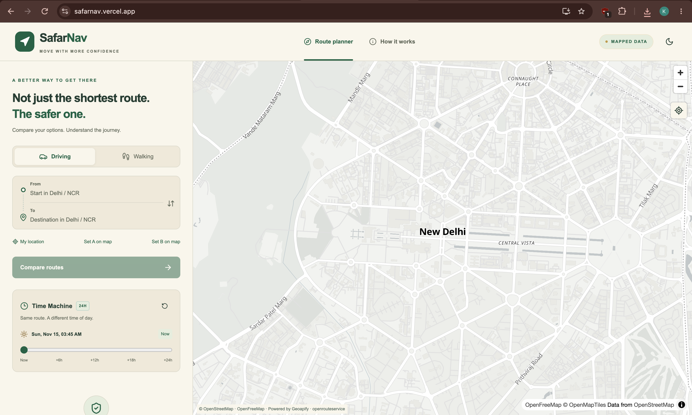
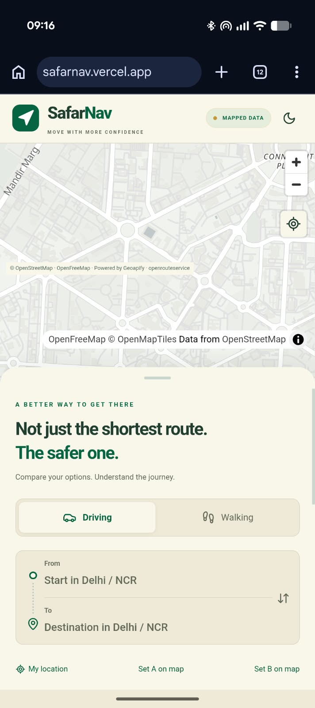

<p align="center">
  
</p>

**Not just the shortest route. The safer one.**

SafarNav compares driving and walking routes using mapped infrastructure, travel time and conditions at the planned departure time. It considers road suitability, lighting, nearby facilities, mapped cameras and expected business opening hours. Its scoring engine evaluates individual sections and gives weaker stretches extra influence on the final indicator.

Gemini explains the calculated results; it does not assign scores. A computed summary remains available when the API is unconfigured or unavailable.

## One journey. Every screen.

A spacious map on your laptop. A compact planner on your phone.

<table>
  <thead>
    <tr>
      <th width="78%" align="left">Laptop</th>
      <th width="22%" align="left">Phone</th>
    </tr>
  </thead>
  <tbody>
    <tr>
      <td valign="top">
        <a href="docs/images/safarnav-desktop.png">
          
        </a>
      </td>
      <td valign="top">
        <a href="docs/images/safarnav-mobile.jpeg">
          
        </a>
      </td>
    </tr>
  </tbody>
</table>

_Select either screenshot to view it at full size._

## Features

- **Route comparison:** compare available routes by infrastructure indicator, distance and travel time.
- **Place search:** find destinations with autocomplete, landmark lookup and common abbreviations.
- **Time Machine:** change departure time and recalculate time-dependent factors without fetching route geometry again.
- **Explainable scoring:** inspect individual factors and sections to understand why routes differ.
- **Mapped cameras:** view camera counts, their distribution along the route and gaps between nearby areas.
- **Journey monitoring:** track progress with foreground GPS and receive alerts for upcoming sections below 30/100.
- **Route summaries:** get a Gemini-generated explanation, with a computed fallback when needed.
- **Navigation handoff:** open Google Maps with a route-shaping waypoint or review an Uber pickup and destination handoff.
- **Post-journey feedback:** collect ratings and observations about lighting, activity and route concerns, with optional database persistence.
- **Accessible interface:** use keyboard-accessible place search, responsive layouts and light or dark themes with tested text contrast.
- **Demo experience:** explore the workflow with explicitly labelled fictional data.

Indicators describe available infrastructure, not a probability of personal safety. Google Maps calculates its own directions between waypoints, so the handoff cannot lock every road segment. The current Uber integration opens a handoff; it does not book rides or control the driver's route.

## Prospective features

These ideas are not part of the current release.

- **Deeper Uber integration:** extend the existing handoff with supported ride estimates, booking and trip-status features where partner APIs and permissions allow. Keep route and stop preferences visible before the user confirms a ride.
- **Feedback-informed scoring:** use post-journey ratings and section observations as additional route evidence. Start with aggregated trends, then evaluate a machine learning model that helps adjust scoring weights and identify changing conditions.
- **Validated model updates:** compare learned scores with the existing deterministic baseline before deploying changes. Account for sparse feedback, repeated submissions, reporting bias and differences between travel modes. Measure whether predictions improve rather than assuming more feedback makes scores more precise.
- **Route-specific observations:** let users attach feedback to particular sections and travel times, helping distinguish a recurring issue from a single experience.
- **Data freshness:** track the age and source of observations so recent, corroborated reports can be distinguished from older records.
- **Stronger service reliability:** introduce shared caching, durable rate limits and dedicated infrastructure providers for deployments serving more users.

## Implementation techniques

- **Section-based scoring.** The [scoring engine](src/lib/scoring/engine.ts) divides routes into approximately 150-metre sections. It combines the observed-section average with the weakest fifth of the route, preventing a strong average from hiding a poor stretch. [Scoring configuration](src/lib/scoring/config.ts) keeps weights, radii and policy constants separate.

- **Arrival-aware opening hours.** [Opening-hours evaluation](src/lib/scoring/hours.ts) checks schedules at the traveller's estimated passing time in the location's timezone. Missing schedules and unsupported holiday rules remain unknown.

- **Encrypted route snapshots.** [Session handling](src/lib/session.ts) compresses and encrypts route snapshots with AES-256-GCM. Expiring snapshots support rescoring across serverless requests without storing every journey in a database.

- **Controlled provider traffic.** The [Overpass client](src/lib/providers/overpass-client.ts) shares identical in-flight requests, serializes work within a process and observes cooldowns. Requests use [`AbortSignal.timeout()`](https://developer.mozilla.org/en-US/docs/Web/API/AbortSignal/timeout_static) to bound waiting time. A [fallback adapter](src/lib/providers/infrastructure.ts) retrieves limited Geoapify place data when Overpass fails.

- **Persistent map instances.** The [map component](src/components/Map.tsx) updates GeoJSON sources instead of recreating the map after each route selection. A [build script](scripts/prepare-map.mjs) copies version-matched MapLibre [Web Worker](https://developer.mozilla.org/en-US/docs/Web/API/Web_Workers_API) assets for local delivery.

- **Permission-aware monitoring.** The [journey component](src/components/Journey.tsx) uses [`watchPosition()`](https://developer.mozilla.org/en-US/docs/Web/API/Geolocation/watchPosition) and the [Page Visibility API](https://developer.mozilla.org/en-US/docs/Web/API/Page_Visibility_API). Monitoring pauses when the page is hidden. [Notification handling](src/lib/notifications/) retains on-screen alerts when browser notifications are unavailable.

- **Validated AI output.** The [summary service](src/lib/ai/index.ts) validates structured Gemini responses, rejects unexpected recommendations and prohibited summary text, and falls back to deterministic output.

- **Shared theme tokens.** [Global styles](src/app/globals.css) use [CSS custom properties](https://developer.mozilla.org/en-US/docs/Web/CSS/Using_CSS_custom_properties) for both themes. Browser tests check rendered contrast rather than only checking theme classes.

## Stack and notable libraries

The application uses [Next.js](https://nextjs.org/), [React](https://react.dev/), [TypeScript](https://www.typescriptlang.org/) and [Tailwind CSS](https://tailwindcss.com/), with [Lucide](https://lucide.dev/) icons.

| Library                                                                                                                   | Role                                                                             |
| ------------------------------------------------------------------------------------------------------------------------- | -------------------------------------------------------------------------------- |
| [MapLibre GL JS](https://maplibre.org/maplibre-gl-js/docs/)                                                               | Interactive map rendering, route layers and POI interaction.                     |
| [Turf.js](https://turfjs.org/)                                                                                            | Route slicing, proximity calculations, along-route positions and overlap checks. |
| [opening_hours.js](https://github.com/opening-hours/opening_hours.js)                                                     | Parses OpenStreetMap business schedules.                                         |
| [tz-lookup](https://www.npmjs.com/package/tz-lookup) and [date-fns-tz](https://github.com/marnusw/date-fns-tz)            | Coordinate-based timezone lookup and local-time conversion.                      |
| [SunCalc](https://github.com/mourner/suncalc)                                                                             | Estimates daylight from location and departure time.                             |
| [Zod](https://zod.dev/)                                                                                                   | Runtime validation of requests, provider responses and AI output.                |
| [Google Gen AI SDK](https://github.com/googleapis/js-genai)                                                               | Structured Gemini summaries with a computed fallback.                            |
| [Drizzle ORM](https://orm.drizzle.team/) and [Neon serverless driver](https://neon.com/docs/serverless/serverless-driver) | Typed PostgreSQL persistence for optional journey feedback.                      |

Geographic services include [openrouteservice](https://openrouteservice.org/), [OpenStreetMap](https://www.openstreetmap.org/copyright), [Overpass](https://wiki.openstreetmap.org/wiki/Overpass_API), [Geoapify](https://apidocs.geoapify.com/) and [OpenFreeMap](https://openfreemap.org/).

### Typography

The interface uses locally available [Arial](https://learn.microsoft.com/en-us/typography/font-list/arial), followed by [Helvetica](https://www.myfonts.com/collections/helvetica-font-linotype/) and the browser's generic sans-serif fallback. No custom webfont files are bundled or downloaded by the application stylesheet.

## Project structure

```text
.
├── .env.example
├── .gitignore
├── README.md
├── package.json
├── package-lock.json
├── next.config.ts
├── tsconfig.json
├── drizzle.config.ts
├── eslint.config.mjs
├── playwright.config.ts
├── postcss.config.mjs
├── vitest.config.mts
├── docs/
│   └── images/
├── drizzle/
│   └── meta/
├── public/
│   └── maplibre/
├── scripts/
├── src/
│   ├── app/
│   │   └── api/
│   │       ├── ai/
│   │       │   └── route-summary/
│   │       ├── feedback/
│   │       ├── geocode/
│   │       ├── health/
│   │       ├── pois/
│   │       ├── routes/
│   │       │   └── rescore/
│   │       └── uber/
│   │           └── link/
│   ├── components/
│   ├── lib/
│   │   ├── ai/
│   │   ├── cache/
│   │   ├── db/
│   │   ├── geo/
│   │   ├── notifications/
│   │   ├── providers/
│   │   ├── scoring/
│   │   ├── uber/
│   │   └── validation/
│   └── types/
└── tests/
    └── e2e/
```

- [src/app/api/](src/app/api/) contains server-side endpoints for planning, rescoring, summaries and feedback.
- [src/lib/providers/](src/lib/providers/) isolates external services and demo fixtures from application logic.
- [src/lib/scoring/](src/lib/scoring/) contains deterministic scoring, schedule evaluation and camera metrics.
- [public/](public/) contains the SVG application icon, web manifest and notification service worker. MapLibre worker assets are generated during development and builds and excluded from Git. README screenshots are stored in [docs/images/](docs/images/).
- [drizzle/](drizzle/) contains SQL migrations and migration metadata.
- [tests/](tests/) contains unit and component tests; [tests/e2e/](tests/e2e/) covers browser journeys and theme contrast.

## Verification and boundaries

The release has passed 66 automated tests and 10 desktop/mobile browser tests, alongside lint, TypeScript and a production build. Tests use [Vitest](https://vitest.dev/), [Testing Library](https://testing-library.com/) and [Playwright](https://playwright.dev/).

Provider availability, live Gemini credentials, database persistence and physical-device notification behavior require separate verification. Caches and rate limits are process-local; journey monitoring requires foreground GPS access. The notification service worker does not provide background navigation or offline maps.

Further details are documented in the [architecture](docs/ARCHITECTURE.md), [provider notes](docs/PROVIDERS.md), [verification record](docs/VERIFICATION.md) and [deployment checklist](docs/DEPLOYMENT.md).
